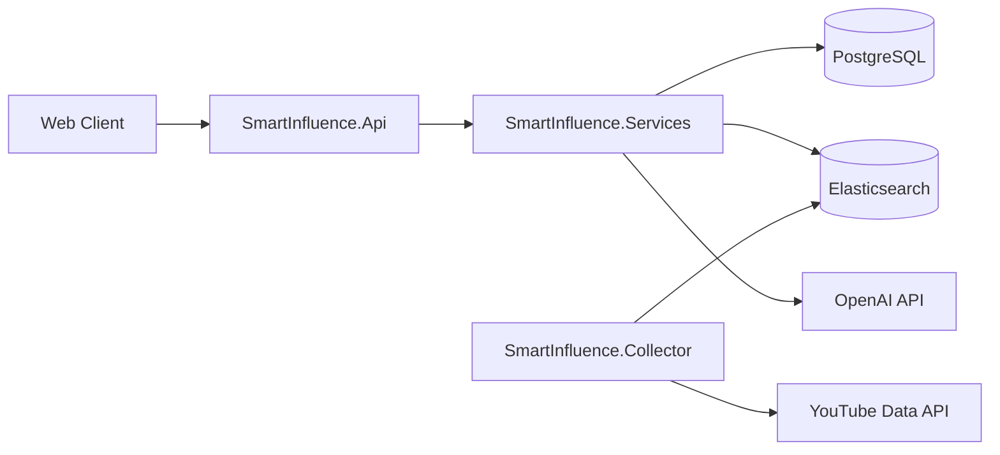

# SmartInfluence Backend

Backend API for **SmartInfluence** — a platform that helps brands discover, evaluate, and manage YouTube influencers. The system combines YouTube channel analytics, Elasticsearch-powered search, and OpenAI-driven product matching to recommend creators that fit a brand's campaign.

## Features

- **Client management** — register brands, authenticate with JWT, and manage account profiles
- **AI-powered matching** — parse product descriptions into channel and video tags using OpenAI
- **Influencer recommendations** — search indexed YouTube creators by niche, country, subscriber count, and average views
- **Campaign tracking** — save recommended influencers, assign scores, and track relationship status per client
- **AI channel reviews** — generate concise Ukrainian-language summaries of a channel's content and audience fit
- **Data collection pipeline** — standalone collector that ingests Ukrainian YouTube channels into Elasticsearch
- **Interactive API docs** — Swagger UI with JWT bearer authentication support

## Architecture



| Layer | Project | Responsibility |
|-------|---------|----------------|
| API | `SmartInfluence.Api` | REST endpoints, JWT auth, Swagger, CORS |
| Services | `SmartInfluence.Services` | Business logic, AI integration, Elasticsearch queries |
| Data | `SmartInfluence.Data` | EF Core entities, repositories, PostgreSQL migrations |
| Collector | `SmartInfluence.Collector` | YouTube channel ingestion and Elasticsearch indexing |

## Tech Stack

- [.NET 10](https://dotnet.microsoft.com/) / ASP.NET Core
- [PostgreSQL](https://www.postgresql.org/) with Entity Framework Core
- [Elasticsearch 8.x](https://www.elastic.co/elasticsearch/)
- [OpenAI API](https://platform.openai.com/) (`gpt-4.1` by default)
- [YouTube Data API v3](https://developers.google.com/youtube/v3)
- JWT Bearer authentication with BCrypt password hashing
- Docker for API deployment and local Elasticsearch

## Prerequisites

- [.NET 10 SDK](https://dotnet.microsoft.com/download)
- [PostgreSQL](https://www.postgresql.org/download/) (local or hosted)
- [Docker](https://www.docker.com/) (for Elasticsearch via Compose)
- API keys for:
  - OpenAI
  - YouTube Data API (collector only)
  - Elasticsearch (if using Elastic Cloud)

## Getting Started

### 1. Clone the repository

```bash
git clone https://github.com/<your-org>/sis-backend.git
cd sis-backend
```

### 2. Start Elasticsearch

From the `SmartInfluence` directory:

```bash
docker compose up -d
```

This starts Elasticsearch on `http://localhost:9200` with security disabled for local development.

### 3. Configure the API

Create `SmartInfluence/SmartInfluence.Api/appsettings.json` (this file is gitignored):

```json
{
  "ConnectionStrings": {
    "PostgreSqlConnection": "Host=localhost;Port=5432;Database=smartinfluence;Username=postgres;Password=your_password"
  },
  "Jwt": {
    "Key": "your-secret-key-at-least-32-characters-long",
    "Issuer": "SmartInfluence",
    "Audience": "SmartInfluence"
  },
  "Elasticsearch": {
    "Url": "http://localhost:9200",
    "DefaultIndex": "youtube",
    "ApiKey": ""
  },
  "OpenAI": {
    "ApiKey": "sk-...",
    "Model": "gpt-4.1"
  }
}
```

For Elasticsearch Cloud, set `Url` and either `ApiKey` or `Username` / `Password` instead of leaving `ApiKey` empty.

### 4. Apply database migrations

```bash
dotnet ef database update \
  --project SmartInfluence/SmartInfluence.Data \
  --startup-project SmartInfluence/SmartInfluence.Api
```

### 5. Run the API

```bash
dotnet run --project SmartInfluence/SmartInfluence.Api
```

The API starts at `http://localhost:6000`. Open Swagger at `/swagger`.

### 6. (Optional) Run the YouTube collector

Create `SmartInfluence/SmartInfluence.Collector/appsettings.json`:

```json
{
  "YouTube": {
    "ApiKey": "your-youtube-api-key"
  },
  "Elasticsearch": {
    "Url": "http://localhost:9200",
    "DefaultIndex": "youtube",
    "ApiKey": ""
  }
}
```

Then run:

```bash
dotnet run --project SmartInfluence/SmartInfluence.Collector
```

The collector searches predefined Ukrainian topic queries, fetches channel and video metadata, computes statistics and interest tags, and indexes documents into Elasticsearch.

## Docker Deployment

Build and run the API container from the repository root:

```bash
docker build -t smartinfluence-api .
docker run -p 10000:10000 \
  -e ConnectionStrings__PostgreSqlConnection="Host=...;Database=...;Username=...;Password=..." \
  -e Jwt__Key="your-secret-key" \
  -e Jwt__Issuer="SmartInfluence" \
  -e Jwt__Audience="SmartInfluence" \
  -e Elasticsearch__Url="http://elasticsearch:9200" \
  -e OpenAI__ApiKey="sk-..." \
  smartinfluence-api
```

The container listens on port `10000`.

## API Overview

| Method | Endpoint | Auth | Description |
|--------|----------|------|-------------|
| `POST` | `/api/client` | — | Register a new client |
| `POST` | `/api/client/login` | — | Authenticate and receive a JWT |
| `GET` | `/api/client/influencers` | JWT | List influencers linked to the authenticated client |
| `PUT` | `/api/client` | JWT | Update the authenticated client's profile |
| `POST` | `/api/influencer/recommendations` | JWT | Get AI-matched influencer recommendations |
| `POST` | `/api/influencer/add-influencer/{clientId}` | JWT | Save a recommended channel to a client's list |
| `GET` | `/api/influencer/clientInfluencers/{clientId}` | JWT | List influencers for a specific client |
| `GET` | `/api/elasticsearch/bloggerTags` | JWT | Retrieve aggregated channel and video tags |
| `GET` | `/api/ai/review/{channelId}` | JWT | Generate an AI review for a YouTube channel |

Protected endpoints require an `Authorization: Bearer <token>` header. Obtain a token via `/api/client/login`.

### Recommendation request example

```json
POST /api/influencer/recommendations
{
  "description": "Organic skincare brand targeting young women interested in natural beauty routines",
  "country": "UA",
  "tags": ["краса", "догляд"],
  "minFollowersCount": 10000,
  "minAvgViews": 5000,
  "resultCount": 5
}
```

The service parses the description with OpenAI, builds an Elasticsearch query from the generated tags, applies the filters, and returns ranked channel recommendations.

## Project Structure

```
sis-backend/
├── Dockerfile
├── README.md
└── SmartInfluence/
    ├── SmartInfluence.sln
    ├── compose.yaml
    ├── SmartInfluence.Api/          # REST API entry point
    ├── SmartInfluence.Services/     # Business logic and integrations
    ├── SmartInfluence.Data/         # EF Core, entities, repositories
    └── SmartInfluence.Collector/    # YouTube → Elasticsearch pipeline
```

## Development

Restore and build the full solution:

```bash
dotnet restore SmartInfluence/SmartInfluence.sln
dotnet build SmartInfluence/SmartInfluence.sln
```

CORS is configured for local frontends at `http://localhost:3000` and `https://olehskomorokha.github.io`.

## License

This project is proprietary. Contact the maintainers for usage terms.
